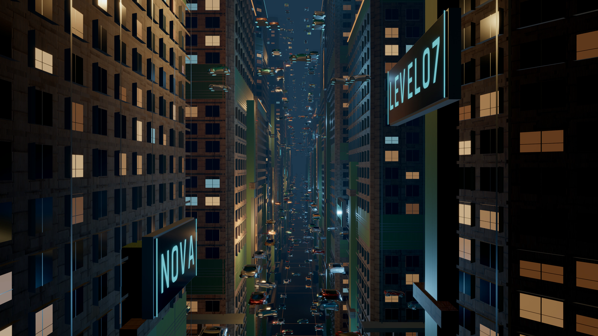
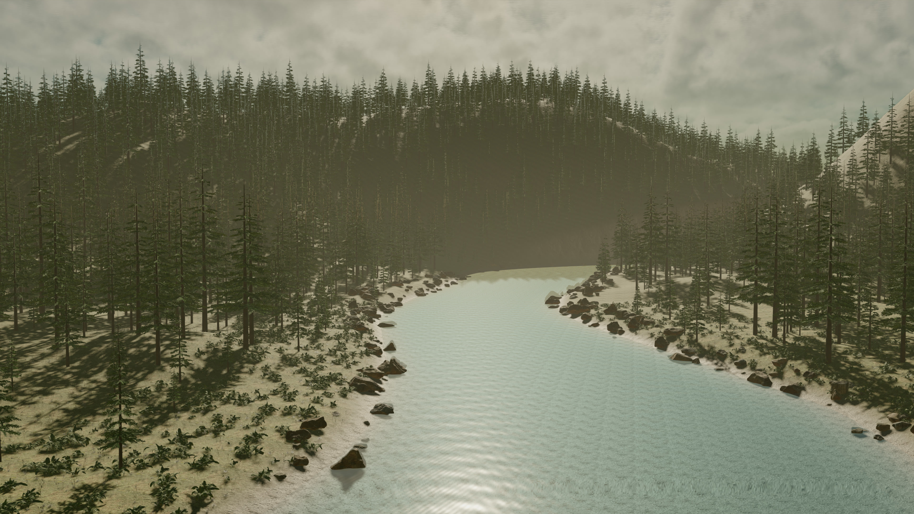
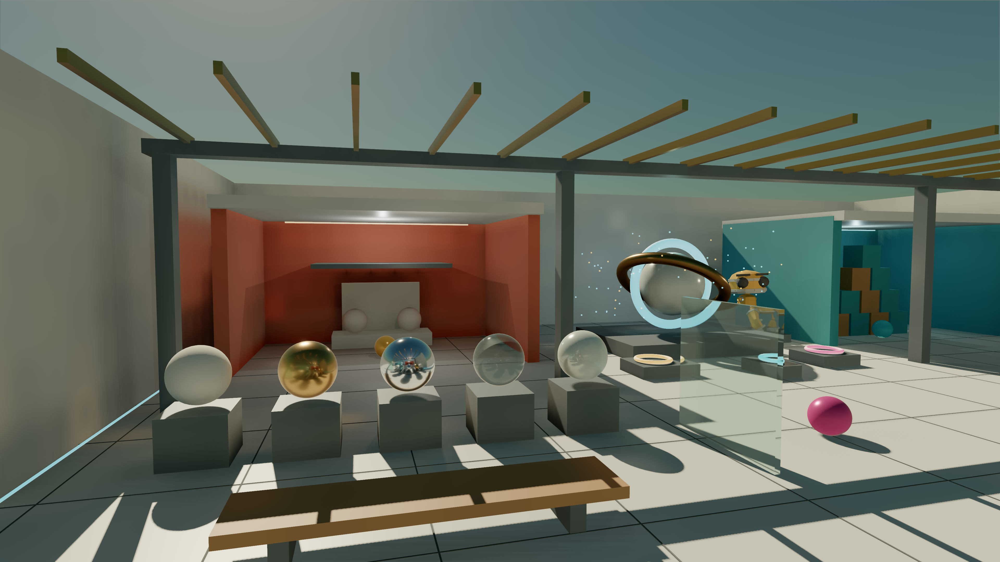
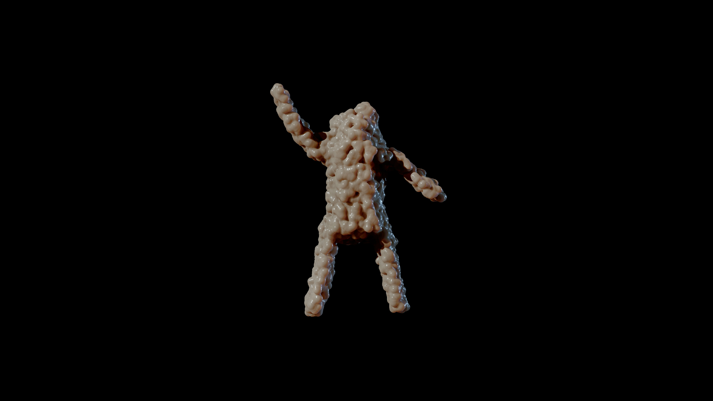
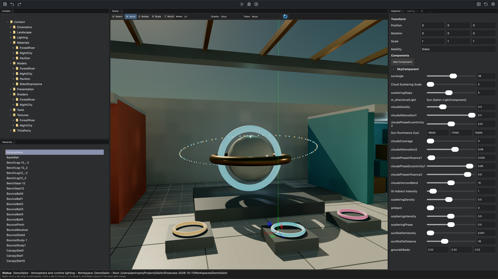

# Sailor Engine

**Sailor Engine** is an independent real-time engine for games, visual effects, interactive art, and experimental demos. It combines a bindless `Vulkan 1.3` renderer with a multithreaded `C++20` runtime, custom memory allocators, and a data-driven frame graph.

The editor is built in **C# with .NET MAUI**, with component-based scene authoring, landscape tools, and project build workflows. Its MCP integration lets AI assistants work directly with scenes, assets, and components through the editor.

Sailor is a long-running passion project rooted in a lifetime of work with computer graphics. The engine's core was originally designed and written by hand, with a focus on extensible rendering and creative experimentation.

**In active development.** Current desktop targets are Windows and macOS. Linux, Android, and iOS ports are under evaluation.

## Showcase

[**Watch the first public showcase on YouTube**](https://youtu.be/WgifakC2LU0): the editor, runtime global illumination, ECS-driven traffic, water and physics, and interactive visuals. ForestRiver and NightCity were created with AI through Sailor's engine integration. This is development footage, not a performance benchmark.

Please visit the Wiki to explore the engine's technical design in detail: [**Technical Overview and Details**](https://github.com/aantropov/sailor/wiki).

## Get Started

The **Sailor** Wiki provides a centralized resource for all aspects of the engine [Build Instructions and Documentation](https://github.com/aantropov/sailor/wiki)
Visit the Wiki to explore everything you need to get started, understand the engine's internals, and contribute to its development.

**Set sail on your game development journey with Sailor Engine!**

## Screenshots

Four native 4K captures. Click an image to view it at full resolution.

### ForestRiver

Terrain, vegetation, water, and atmospheric lighting.

### The Light Pavilion

Physically based materials, reflections, and runtime global illumination.

### SwarmAlien

Raymarched forms and interactive visuals for art installations.

### Editor

The C# / .NET MAUI editor, with the Content browser expanded and the Atmosphere object selected in the Inspector.

Screenshot notes and asset credits

Captured with the Ultra preset and resolution factor 1.0. MSAA 8x applies to the relevant raster passes; SwarmAlien uses its own raymarching pass. The editor screenshot includes the complete application window. SwarmAlien uses synthetic audience input in this capture, not a live webcam recording.

ForestRiver includes [Poly Haven](https://polyhaven.com) assets (CC0). The pavilion includes [RobotExpressive](https://github.com/mrdoob/three.js/tree/dev/examples/models/gltf/RobotExpressive) by Tomas Laulhe / Quaternius, with modifications by Don McCurdy (CC0).

NightCity uses [Car Concept](https://github.com/KhronosGroup/glTF-Sample-Assets/tree/main/Models/CarConcept) by Eric Chadwick, Darmstadt Graphics Group GmbH (2024), adapted for DemoSailor under [CC BY 4.0](https://creativecommons.org/licenses/by/4.0/). Logos and trademarks retain their respective owners' rights; no endorsement is implied.

## Features

- **Rendering:** Bindless Vulkan renderer, data-driven frame graph, Forward+ lighting, physically based materials, GPU frustum and occlusion culling, and mesh LODs.
- **Lighting and atmosphere:** Baked and runtime GI probes, local reflections, cascaded shadow maps, atmospheric sky, volumetric clouds, and fog.
- **Visual effects:** Raymarching, GPU particles, CPU path tracing, MSAA, camera and object motion blur, bloom, exposure, and tone mapping.
- **Worlds and simulation:** Component-based scenes, ECS, skeletal animation, Jolt physics, and landscape and vegetation streaming.
- **Core:** Task-based multithreading, parallel render preparation, custom memory allocators, and engine-owned containers.
- **Editor:** C# / .NET MAUI, component and asset inspectors, landscape authoring, and workspace build and reload tools.
- **AI-assisted workflows:** MCP tools for scene creation, asset inspection, component editing, and editor automation.
- **Engine development:** C++20 with MSVC and Clang; extensible components, ECS systems, and rendering nodes for project-specific behavior.

## Dependencies

This project uses [vcpkg](https://github.com/microsoft/vcpkg) to manage C++ dependencies. Run `python update_deps.py` to install the required packages.

## Sponsorship and Contribution

**Support Sailor Engine's Development**  
Your support can help drive the development of new features, improved performance, and expanded documentation. Become a sponsor and play a role in shaping the future of Sailor Engine.

- [Sponsor the Project](https://github.com/sponsors/aantropov)

**Contribute to Sailor Engine**  
We welcome contributions from developers of all levels! Whether you want to fix a bug, add a feature, or improve documentation, your help is invaluable.

- Fork the repository and submit a Pull Request.
- Discuss features, ideas, or issues.
